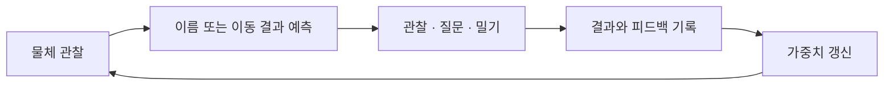

# Nascen

**경험으로 자라는 AI.**

*An AI that learns to grow.*

Nascen is an open-source research project on how agents learn from interaction, form concepts, and adapt over time.

[](https://github.com/uiwwsw/nascen/actions/workflows/ci.yml) [](LICENSE)

## Nascen이 꿈꾸는 것

빨간 공을 보고 사람에게 이름을 배운 에이전트가 처음 본 파란 공도 알아볼 수 있을까요? 틀린 예측을 했을 때 어디가 헷갈렸는지 알아차리고, 다음에 무엇을 관찰하거나 물어볼지 스스로 고를 수 있을까요?

Nascen은 작은 세계에서 **보고, 예측하고, 시도하고, 다시 배우는 과정**을 연구합니다. 장기적으로는 각각 배운 색·형태·행동을 조합해 처음 받는 요청도 수행하는 에이전트를 만들고 싶습니다. 더 적은 가르침으로도 배우는지, 새로 배운 뒤에도 예전 지식을 사용할 수 있는지, 사람의 평가가 행동을 어떻게 바꾸는지를 따로 측정합니다.

이름 Nascen(나센)은 ‘태어나다’를 뜻하는 라틴어 *nascī*에서 따왔습니다.

## 첫 번째 실험

에이전트는 사전학습 없이 무작위 가중치와 빈 경험 기록에서 출발합니다. 8×6 시뮬레이션에 놓인 물체를 관찰하고, 멘토에게 색과 형태를 묻거나, 물체를 밀어서 움직일지 예측합니다.



- **학습**은 합성 픽셀에서 추출한 평균 RGB와 윤곽을 이용합니다. 개념 모델은 멘토 답변으로 색과 형태를, 전이 모델은 밀기의 실제 결과로 이동 여부를 배웁니다. 최근 경험 일부를 재사용하는 replay를 끌 수 있습니다.
- **동기**는 이동 성공, 멘토 평가, 예측 개선, 새 질문을 보상에 반영합니다. 학습 정책은 이 보상과 후보 행동의 탐색 횟수를 함께 고려합니다. 멘토 타일을 침범하는 밀기는 시뮬레이터의 규칙이 실행 전에 차단합니다.
- **기록**은 SQLite에 경험과 모델 체크포인트로 남습니다. 다시 실행하면 이어서 학습하며, `reset`은 새 기록을 시작합니다.

첫 MVP에서 ‘이름을 배운다’는 것은 고정된 색·형태 범주를 관찰에 연결하는 것을 뜻합니다. 벤치마크에 쓰는 관찰과 멘토 답변은 시뮬레이터가 생성하며, 에이전트의 행동도 그 안에서만 일어납니다.

## 바로 실행하기

Python 3.12~3.14와 CPU를 사용합니다. Linux x86-64와 macOS 14 이상 Apple Silicon에서 검증했습니다.

```sh
git clone https://github.com/uiwwsw/nascen.git
cd nascen
python3 -m venv .venv
source .venv/bin/activate
python -m pip install -r requirements.txt

python -m nascen status
python -m nascen train --steps 50
```

새 데이터베이스에서는 에이전트가 실제로 이동하는 실험이 시작됩니다. `status`에서 에이전트의 위치와 시야에 들어온 물체의 번호 및 추측을 확인할 수 있습니다. 기존 v0.1 실험은 저장한 가중치와 기존 세계 규칙으로 이어집니다.

```sh
# 새 시드 42 실행에서 시작 위치에 보이는 물체
python -m nascen reset --seed 42 --question-budget 10
python -m nascen teach 2
python -m nascen feedback +1
python -m nascen --json status

# v0.1 기준 실험을 같은 시드에서 재현
python -m nascen reset --world legacy --seed 42 --strategy random
python -m nascen train --steps 50
```

`--db PATH`를 명령 앞에 두면 별도 SQLite 파일을 사용합니다. 기본 경로는 `.nascen/lab.sqlite3`입니다. `reset`에 `--no-replay`를 더하면 새 경험만으로 모델을 갱신합니다. 이동 실험에서 `--encoder factored`는 기존 시각 모델을 사용하며, `--questions`로 질문 전략을 고릅니다.

## 첫 측정 결과

조건마다 동일한 5개 시드로 300단계씩 실행했습니다. 학습 세계에서 뺀 색·형태 조합 4개를 새 합성 이미지 32장으로 평가했고, **한 이미지의 색과 형태를 모두 맞혀야** 정답으로 집계했습니다.

| 탐색 | Replay | 응답 제한 없음 · 정확도 | 평균 응답 수 | 응답 40회 · 정확도 |
| --- | --- | ---: | ---: | ---: |
| 능동 | 사용 | **59.4%** | 106.8 | **39.4%** |
| 무작위 | 사용 | 36.2% | 53.6 | 30.6% |
| 능동 | 끔 | 36.9% | 107.2 | 24.4% |

무작위 가중치의 평균 초기 정확도는 6.2%였습니다. 질문을 제한하지 않았을 때 능동 탐색은 무작위 탐색의 약 두 배에 해당하는 답변을 받았습니다. 40회 조건에서는 모든 실행이 같은 수의 답변을 받았고 격차는 8.8%p로 줄었습니다. 시드에 따라 순위가 바뀌며, 질문 시점과 replay 연산량도 조건마다 다릅니다.

```sh
python -m nascen.benchmark
python -m nascen.benchmark --question-budget 40
python -m unittest discover -s tests -v
```

50단계 간격의 학습 곡선, 시드별 정확도, 이동 예측 오차를 JSON에서 확인할 수 있습니다. [응답 제한 없음](docs/benchmark-unlimited.json) · [응답 40회](docs/benchmark-budget40.json)

## 다음에 검증할 것

1. **질문을 고르는 능력.** 같은 답변 수와 연산 예산에서 언제, 어떤 물체에 대해 질문할지 비교합니다.
2. **오래 유지되는 지식.** 학습 도중 물체 분포를 바꾸고, 새 조합을 익힌 뒤에도 먼저 배운 조합을 맞히는지 측정합니다.
3. **처음 받는 요청.** 색·모양·밀기를 각각 익힌 에이전트가 처음 받은 ‘파란 상자를 공 쪽으로 밀어’ 같은 지시를 행동으로 옮기는지 실험합니다.

[Apache-2.0](LICENSE)
